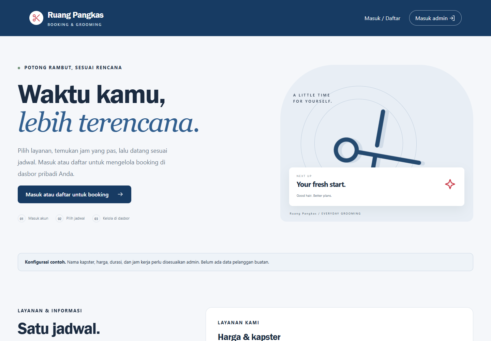
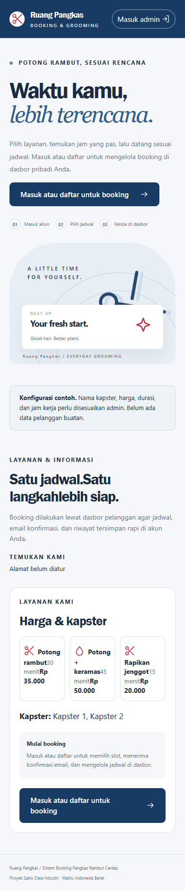

# Ruang Pangkas

Sistem booking pangkas rambut berbasis **Python dan Flask**, dengan SQLite untuk penggunaan lokal dan **Turso/libSQL** untuk website di Vercel. Pelanggan dapat memilih layanan, kapster, dan jadwal; admin mengelola booking serta operasional melalui dasbor.

**[Buka aplikasi](https://sistem-booking-pangkas-rambut-cerda.vercel.app/)** · [Panduan deployment](docs/DEPLOYMENT.md) · [Detail fitur dan operasional](docs/FEATURES.md)

## Tampilan halaman utama

Klik gambar untuk membuka website.

[](https://sistem-booking-pangkas-rambut-cerda.vercel.app/)

<details>
<summary>Lihat tampilan pada HP</summary>

<p align="center">

</p>

</details>

*Screenshot halaman publik diambil pada 16 November 2026. Nama usaha, layanan, dan harga dapat diubah admin.*

## Fitur utama

- **Akun pelanggan:** masuk dengan Google atau email dan password, verifikasi email, profil, dan riwayat booking.
- **Booking:** pilihan slot tersedia, pemeriksaan bentrok jadwal, perubahan jadwal, dan pembatalan.
- **Dasbor admin:** kalender pelanggan, walk-in, status layanan, pencatatan pembayaran, serta pengaturan layanan, kapster, dan jam kerja.
- **Notifikasi:** pembaruan di dasbor, email konfirmasi/perubahan/pembatalan, pengingat opsional, dan Web Push untuk admin.
- **Analisis:** perkiraan kedatangan, saran jam promo, dan risiko no-show berdasarkan statistik historis. Fitur ini merupakan baseline statistik, belum model machine learning terlatih.
- **Satu akun admin:** penggantian akun melalui alat terminal dengan kode khusus.

## Teknologi

| Bagian | Teknologi |
| --- | --- |
| Backend | Python 3.12, Flask |
| Database | SQLite lokal atau Turso/libSQL online |
| Antarmuka | HTML, CSS, JavaScript |
| Login Google | OAuth 2.0 |
| Pemberitahuan | SMTP dan Web Push |
| Hosting | Vercel |

## Menjalankan secara lokal

Pasang **Python 3.12**, buka folder proyek di VS Code, lalu jalankan di terminal PowerShell:

```powershell
python -m venv .venv
.venv\Scripts\python.exe -m pip install -r requirements.txt
if (-not (Test-Path .env)) { Copy-Item .env.example .env }
.venv\Scripts\python.exe app.py
```

Sesuaikan `.env` berdasarkan `.env.example`. Tanpa konfigurasi Turso, gunakan database SQLite lokal. Tidak perlu MySQL atau XAMPP.

| Halaman | Alamat lokal |
| --- | --- |
| Beranda pelanggan | http://127.0.0.1:5000/ |
| Masuk atau daftar pelanggan | http://127.0.0.1:5000/masuk |
| Dasbor pelanggan | http://127.0.0.1:5000/dasbor |
| Masuk admin | http://127.0.0.1:5000/login |
| Membuat admin pertama | http://127.0.0.1:5000/setup |

Halaman `/setup` hanya untuk pembuatan admin pertama. Setelah akun tersedia, gunakan halaman masuk admin. Hentikan server dengan **Ctrl+C**; data lokal tetap tersimpan di `instance/`.

## Konfigurasi

| Kebutuhan | Variabel lingkungan |
| --- | --- |
| Kunci sesi aplikasi | `SECRET_KEY` |
| Database online | `TURSO_DATABASE_URL`, `TURSO_AUTH_TOKEN` |
| Alamat website | `PUBLIC_BASE_URL` |
| Login Google | `GOOGLE_CLIENT_ID`, `GOOGLE_CLIENT_SECRET`, `GOOGLE_REDIRECT_URI` |
| Email | `MAIL_MODE`, `SMTP_HOST`, `SMTP_PORT`, `SMTP_USER`, `SMTP_PASSWORD`, `MAIL_FROM` |
| Penggantian admin | `ADMIN_CHANGE_CODE` |
| Scheduler online | `CRON_SECRET` |

Gunakan `.env.example` sebagai acuan lengkap. **Jangan unggah `.env`, token, sandi aplikasi Gmail, kunci lokal, atau database pelanggan ke GitHub.** Di Vercel, masukkan variabel pada Environment Variables untuk lingkungan yang dipakai, lalu redeploy.

`MAIL_MODE=demo` hanya melakukan simulasi. Untuk mengirim email sungguhan, gunakan `MAIL_MODE=smtp` dengan konfigurasi valid. Gmail memerlukan sandi aplikasi, bukan password login Google.

## Struktur proyek

```text
ruang_pangkas/       Logika aplikasi, booking, database, email, dan analisis
scripts/            Alat pengelolaan admin dan konfigurasi
static/             CSS, JavaScript, service worker, dan ikon sumber
templates/          Halaman HTML pelanggan dan admin
tests/              Pengujian aplikasi dan database
docs/               Panduan, hasil pemeriksaan, dan screenshot
instance/           Database dan kunci lokal privat, tidak masuk Git
work/               File privat dan hasil sementara, tidak masuk Git
public/static/      Aset hasil build, jangan diedit langsung
app.py              Menjalankan aplikasi lokal
wsgi.py             Entry point Vercel
```

Perintah penggantian admin: `python admin_account.py`. Alat ini memakai database yang dikonfigurasi; pastikan tujuan SQLite atau Turso sudah benar. Penjelasan lengkap tersedia di [panduan operasional](docs/FEATURES.md#satu-akun-admin-dan-penggantian-akun).

## Pengujian

```powershell
.venv\Scripts\python.exe -m unittest discover -s tests -v
```

Pengujian memakai database sementara dan tidak mengirim email sungguhan.

## Catatan operasional

- Zona waktu **WIB**, slot mulai setiap **15 menit**, dan pemesanan maksimal **60 hari**. Pelanggan dapat mengubah atau membatalkan minimal **60 menit** sebelum jadwal; admin dapat membantu setelah tenggat.
- Email konfirmasi, perubahan jadwal, dan pembatalan booking online tetap dibuat meskipun pelanggan tidak memilih pengingat. Pengingat merupakan pilihan terpisah.
- Status email diterima server SMTP belum menjamin masuk Inbox. Periksa **Admin > Pesan Email**, konfigurasi SMTP, dan folder Spam. Booking tetap tersimpan jika pengiriman email gagal.
- Worker lokal berjalan saat `python app.py` aktif. Pengingat terjadwal di Vercel memerlukan scheduler eksternal yang mengakses `/api/cron/messages` dengan autentikasi `CRON_SECRET`; lihat panduan deployment.
- Pembayaran dicatat manual. Satu lokasi didukung. Jangan membuka satu file SQLite melalui sinkronisasi OneDrive dari beberapa komputer sekaligus.

## Dokumentasi

- [Fitur, aturan booking, email, dan pengelolaan admin](docs/FEATURES.md)
- [Deployment Vercel dan Turso](docs/DEPLOYMENT.md)
- [Hasil pemeriksaan proyek dan prioritas perbaikan](docs/PROJECT_REVIEW.md)
